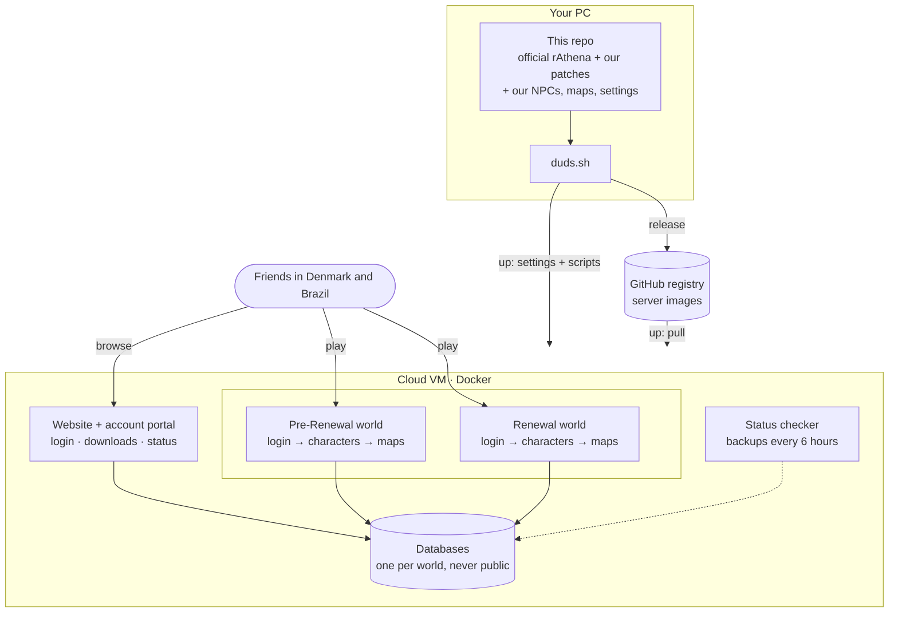

<h1 align="center"></h1>

A private Ragnarok Online server for a group of friends in Denmark and Brazil.
It runs on [rAthena](https://github.com/rathena/rathena), the open-source server, with two worlds:
**Renewal** and **Pre-Renewal** (the classic game). Not affiliated with Gravity.

## How it works



- **Images** are the programs; **settings and scripts** stay outside them, so most changes need no rebuild.
- **Databases** are never open to the internet: only the servers, the portal and the status checker reach them.
- **Passwords and accounts** live in `deploy/hosts/` and never go into git.

## Quick start
```bash
git clone --recurse-submodules https://github.com/dudustri/ragnaduds-server.git
./duds.sh help                 # every command
./duds.sh start local re       # a server on your PC
./duds.sh release              # build the images
./duds.sh up vm                # put everything on the VM
```

Update rAthena: `git -C rathena fetch && git -C rathena checkout <commit>`, then `./duds.sh release`.
The build stops if one of our patches no longer fits. Check `rathena/sql-files/upgrades/` for database changes first.

## Docs
| Doc | For |
|---|---|
| [DEPLOY](docs/DEPLOY.md) | putting it on the VM, day-to-day tasks |
| [OPERATIONS](docs/OPERATIONS.md) | diagrams and every `duds.sh` command |
| [CONFIG](docs/CONFIG.md) | rates and settings, and how to change them |
| [SPECIAL-MAPS](docs/SPECIAL-MAPS.md) | Mapas Especiais, Cheffenia, casino, 4th job quests |
| [BROWSER](docs/BROWSER.md) | playing in the browser (/play, /play-renewal), and the local GRF viewers |
| [grf](grf/README.md) | making your own maps, sprites and effects |
| [CASHSHOP](docs/CASHSHOP.md) | the Cash Shop and cash points |
| [GM-COMMANDS](docs/GM-COMMANDS.md) | GM commands, MVPs, jobs, cards |
| [PORTAL](docs/PORTAL.md) | account requests, website login, password reset |
| [WEBSITE](docs/WEBSITE.md) | the website |
| [SETUP](docs/SETUP.md) | running the servers on your PC |
| [builds](docs/builds/README.md) | class builds used for the shop |

## Folders
```
duds.sh       the command center
rathena/      official rAthena (git submodule)
robrowser/    roBrowserLegacy, the browser client (git submodule)
patches/      our engine changes, applied when the images are built
build/        server images, website, account portal
deploy/       what runs on the VM: compose file, our scripts, settings (hosts/ is private)
cashshop/     Cash Shop builder
casino/       casino art and sounds
client/       tools for the friends' download
docs/         documentation
grf/          your GRF work (maps, sprites, effects), see grf/README.md
vm_provisioning/  setup for a new VM
```
