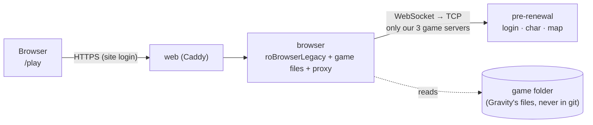
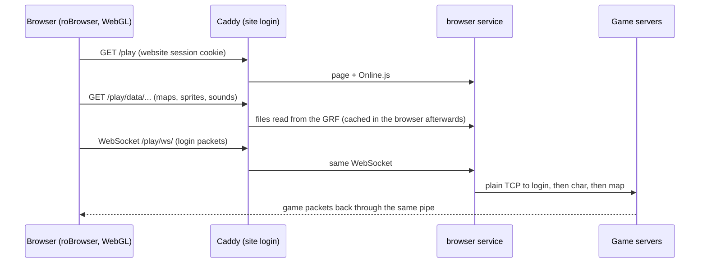

# Play in the browser

Friends play **Pre-Renewal** at **/play** on the website (behind the website login): no install, the game opens
straight on the login screen.



How a session works:

The browser does all the drawing; the server only moves files and game packets, exactly like the desktop client
talks to rAthena.

- **Client**: [roBrowserLegacy](https://github.com/MrAntares/roBrowserLegacy) (GPL-3.0), the `robrowser/` submodule,
  pinned to a tested commit. Settings: `deploy/browser/Config.local.js` (same file on your PC and on the site).
- **Game files + proxy**: [roBrowserLegacy-RemoteClient-JS](https://github.com/FranciscoWallison/roBrowserLegacy-RemoteClient-JS),
  pinned in `build/browser/Dockerfile`. The proxy only reaches our three pre-renewal servers and only accepts pages
  from our site (`BROWSER_ORIGINS`).
- **Image**: `build/browser/` → `ghcr.io/dudustri/duds-server-browser`. No game files inside: they're mounted at run time.
- Renewal isn't in the browser yet (its 2026 packet version is newer than roBrowser handles well).

## Put it on the VM
```bash
./duds.sh release browser web     # the client image + the site with /play
./duds.sh browser-data            # upload the pre-renewal game folder once (~3.4 GB, resumable)
./duds.sh up vm browser web
```
`BROWSER_PRE_GAME` in `deploy/hosts/local/.env` points at your pre-renewal game folder (the source of the upload and
of the local service). The VM keeps its copy in `~/duds/browser-data/pre`.

## On your PC: viewers and GRF work
`./duds.sh start local pre && ./duds.sh up local browser`, then http://127.0.0.1:3338/: the full launcher with the
game and the Map, Model, STR, Effect and GRF viewers. Making your own maps, sprites and effects:
[grf/README.md](../grf/README.md). On the site the launcher and viewers answer 404.
