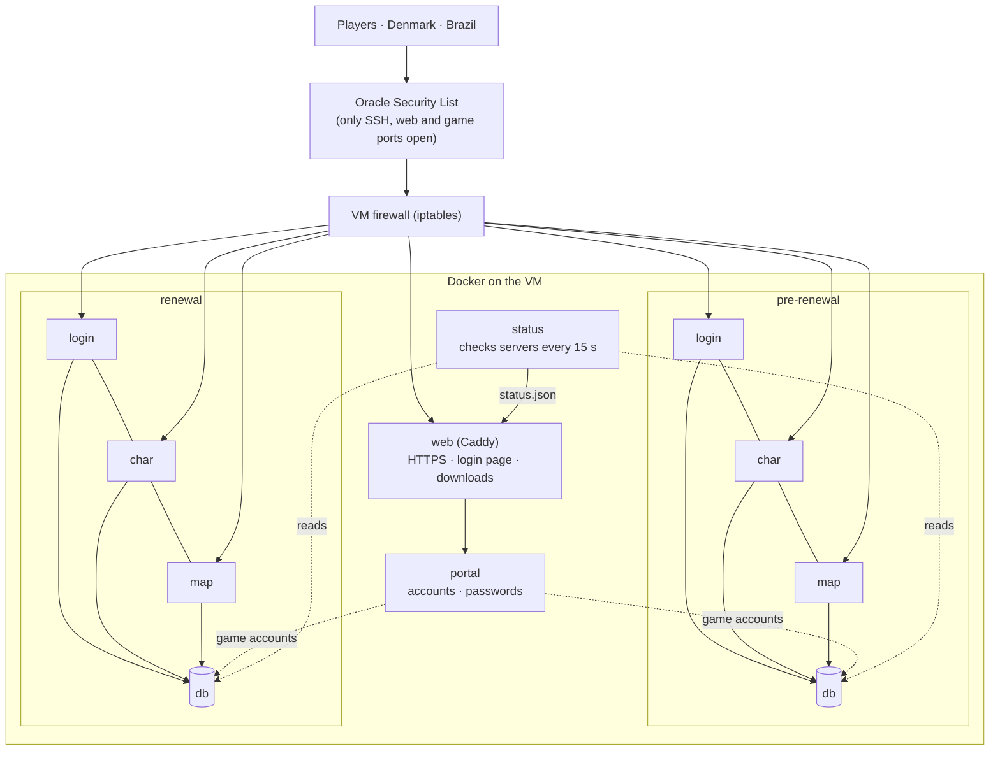
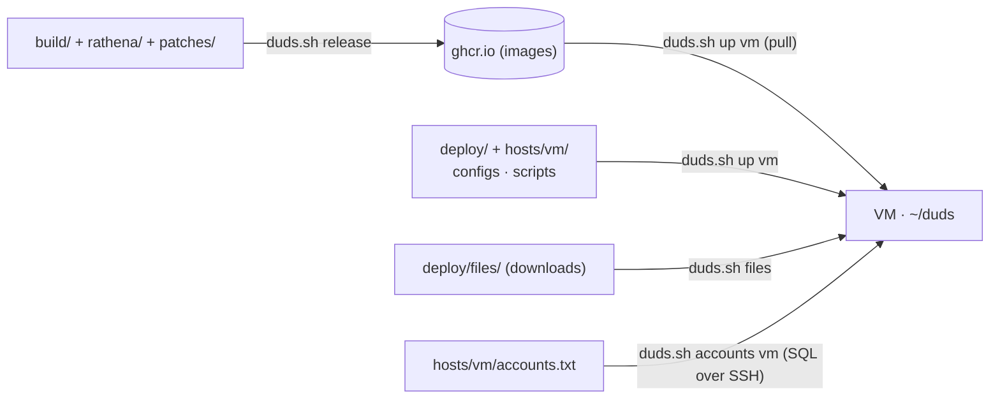

# Operations

## How players reach the server

Databases have no open port; only the game containers, the portal and the status checker reach them.
The exact ports are in `deploy/compose.yml`.

## From your PC to the VM

- Images are the programs; configs live outside them, so config changes need no rebuild.
- The VM never needs the source code.

## Commands (`./duds.sh`)
| Command | Does |
|---|---|
| `release [image…]` | build + push images (`pre_renewal renewal db web portal browser`, default all) |
| `up <local\|vm> [service…]` | start/update (vm: copy files, pull, start). Doesn't restart a server whose image didn't change |
| `restart <host> <service…>` | e.g. `restart vm prere-map re-map` (needed after script changes) |
| `start` / `stop <host> <pre\|re\|all>` | run only the server you want; data stays |
| `ps` · `logs` · `online <host>` | status · live logs · players online |
| `gm <host> <re\|pre> @cmd` | a GM command on a running map server, no restart |
| `config <host> [pre\|re\|gm\|env\|all]` | upload configs only, no restart |
| `accounts <host>` | create/update game accounts from `accounts.txt` (safe to rerun) |
| `add-user <host> <username> <M\|F> [group]` | add/change one account (asks the password; 99 = admin) |
| `set-password <host> <user>` | website login (stored as a token) |
| `package <pre\|re> [address]` · `files` | build a download for friends · upload them (resumable) |
| `browser-data` | upload the pre-renewal game folder the browser client reads ([BROWSER.md](BROWSER.md)) |
| `backup vm` · `autobackup vm` | dump the VM databases to your PC · every 6 h on the VM |
| `ssh` | shell on the VM |

Services: `prere-{db,login,char,map,web}`, `re-{db,login,char,map,web}`, `web`, `portal`, `browser`, `status`. The `*-web`
services are rAthena's web server (account settings + guild emblems for the game).
`up`, `restart` and `stop` ask first if players are online. Multi-step commands show green step headers with a progress bar.

## What friends download
`./duds.sh package pre|re` builds a zip with an installer for Windows and Linux. It unpacks the game, checks every
file, checks that the server answers and creates a **RagnaDuds** shortcut. Running it again on the same folder
reinstalls (settings and screenshots are kept). The homunculus AI (`client/homunculus_ai/`, Mir AI Mod, GPL v2)
is included: players type `/hoai` once in game.

## Shortcuts on your PC
| Shortcut | Does |
|---|---|
| `ssh duds` | log in to the VM |
| `ro2021` / `ro2026` | start the local server if needed + the game |
