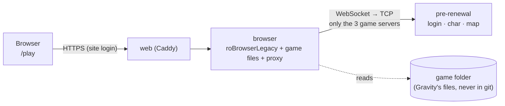
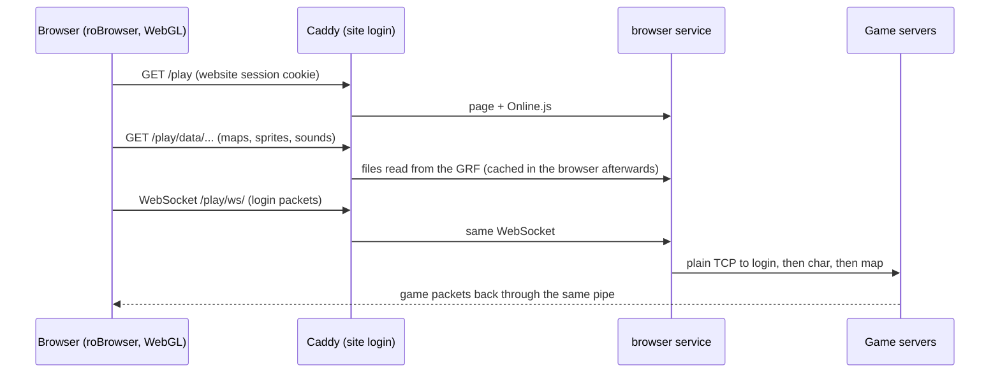

# Play in the browser

Players can play in the browser on the website (behind the website login), no install, straight to the game login:
**/play** for Pre-Renewal and **/play-renewal** for Renewal. Each server has its own `browser` service
(`browser` and `browser-re`): same image, its own game files and settings (`deploy/browser/pre|re/`).



How a session works:

The browser does all the drawing; the server only moves files and game packets, exactly like the desktop client
talks to rAthena.

- **Client**: [roBrowserLegacy](https://github.com/MrAntares/roBrowserLegacy) (GPL-3.0), the `robrowser/` submodule,
  pinned to a tested commit, plus custom fixes in `patches/robrowser/` (applied when the image is built). Settings:
  `deploy/browser/<pre|re>/Config.local.js` (same file locally and on the site).
- **Game files + proxy**: [roBrowserLegacy-RemoteClient-JS](https://github.com/FranciscoWallison/roBrowserLegacy-RemoteClient-JS),
  pinned in `build/browser/Dockerfile`. The proxy only reaches the project's three game servers and only accepts pages
  from the project's site (`BROWSER_ORIGINS`).
- **Image**: `build/browser/` → `ghcr.io/dudustri/duds-server-browser`. No game files inside: they're mounted at run time.
- **Renewal (2026 client)** needed two fixes: its GRFs start with "Event Horizon" instead of "Master of Magic"
  (same format otherwise; the image patches the file server to accept it), and the custom cash shop sends the item preview
  fields (`patches/robrowser/0001-…`); `0002-…` keeps fast cutin animations (the casino) from stacking up. Login, characters and maps work; newer UIs may still be missing in places.

## Put it on the VM
```bash
./duds.sh release browser web     # the client image + the site with /play and /play-renewal
./duds.sh browser-data            # both game folders from the downloads (~3.4 GB + ~5 GB the first time, then only changes)
./duds.sh up vm browser browser-re web
```
The browser's game folders are made **from the player downloads** (`client/browser_data.py`, run by
`./duds.sh browser-data` into `deploy/browser-data/`): the same GRFs in the same order, the music, and the item list
the exe ends up with (its layered loader run once in Lua 5.1 and written out as `System/itemInfo_browser.lua`),
the English System files where roBrowser looks for them (`SystemEN/`), and the custom login picture under the names
roBrowser asks for (`ragnaduds_browser.grf`). Local GRF work (`grf/`) is mounted only on the local machine
(`BROWSER_DEV_DATA` in `deploy/hosts/local/.env`); the VM gets an empty folder. So
after `build_shop.py` → `./duds.sh package re`, run `./duds.sh browser-data` and both clients match. The VM keeps its
copies in `~/duds/browser-data/pre` and `re`.

## Local viewers and GRF work
`./duds.sh start local pre && ./duds.sh up local browser`, then http://127.0.0.1:3338/ (Renewal: `start local re`,
`up local browser-re`, http://127.0.0.1:3339/): the full launcher with the game and the Map, Model, STR, Effect
and GRF viewers. Making custom maps, sprites and effects:
[grf/readme.md](../grf/readme.md). On the site the launcher and viewers answer 404.
