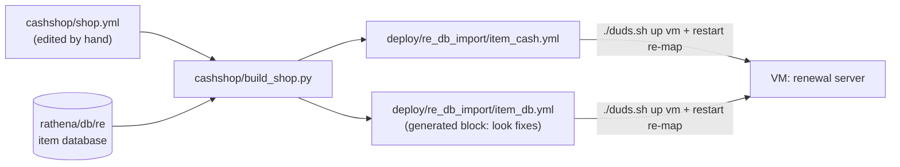

# Cash Shop

The renewal server's Cash Shop: what's in it, how to change it, and how players earn cash points.



`build_shop.py` checks every item, builds the shop and also prepares the item fixes that go into the player
download (rebuilt with `./duds.sh package re`). The command is
`uv run --no-project --with pyyaml --with pillow python3 cashshop/build_shop.py`.

## The shop file

`cashshop/shop.yml` is the only hand-edited file:

```yaml
looks:                       # worn look for items whose own look the client can't draw
  19163: 400110              # item 19163 looks like item 400110

tab_labels:                  # what the game shows on each tab (server tab names are fixed)
  New: Beginner
  ...

tabs:
  New:
    note: "Beginner: Novice and 1st class rush gear"
    items:
      450183: 50             # Id (or AegisName): price in cash points
      1631: auto             # auto = by level: <100 → 100, 100-169 → 200, 170-189 → 400, 190+ → 600 (weapons ×1.5)
```

| Server tab | Shown as | Content |
|---|---|---|
| New | Beginner | Paradise / Eden / Novice rush gear, shadow starter gear, 1st class sets (Merchant Cart Revolution…) |
| Hot | 2nd Class | Paradise 2nd class weapons, 2nd / trans / expanded class sets (Alchemist/Creator Acid…) |
| Limited | 3rd Class | 3rd class sets for lv 100-160, per build |
| Rental | Endgame | 3rd class sets for lv 175-200, per build (Rune Knight Dragon Breath…) |
| Permanent | MVP Cards | |
| Scrolls | Refine | +14 / +19 safe certificates, Blacksmith Blessing, HD ores, costume enchant stones |
| Consumables | Consumables | tickets, manuals, mount, speed, stat foods, acid packs, Ygg, gems, homunculus, mercenaries |
| Other | Pets | eggs, food, accessories |
| Sale | Visuals | costumes |

Where the sets come from: [builds/](builds/readme.md) (researched builds, every Id checked against the server DB),
read by `cashshop/research_sets.py`.

## Cash points
Players earn them by playing (`deploy/cash_points.txt`):

| For | Points |
|---|---|
| first login of the day | 200 |
| every hour played (not AFK) | 60 |
| an MVP kill | 50 (5 in Cheffenia, which has ~190 MVPs per room) |
| a PvP kill | 30 |

`@points` shows them in game; GMs give points with `!cash "Name" <n>`.
**Refine certificates** are used at the Refine Master, prontera 184,177 (`deploy/ticket_refiner.txt`).

## Add an item to the shop
1. Find its Id: `@iteminfo <name>` in game, or search `rathena/db/re/item_db_*.yml`.
2. Add `<id>: <price>` (or `auto`) under the right tab in `cashshop/shop.yml`.
3. Build and ship:
   ```bash
   uv run --no-project --with pyyaml --with pillow python3 cashshop/build_shop.py
   ./duds.sh up vm && ./duds.sh restart vm re-map
   ```
   If `build_shop.py` reports new fixes for the game, also rebuild and upload the download
   (`./duds.sh package re && ./duds.sh files`); players then need to reinstall.

## Files
| File | Role |
|---|---|
| `cashshop/shop.yml` | the shop: tabs, labels, items, prices, look replacements |
| `cashshop/build_shop.py` | checks every item + builds the shop |
| `cashshop/research_sets.py` + [builds/](builds/readme.md) | the researched class sets |
| `deploy/re_db_import/item_cash.yml`, `item_db.yml` | generated server files (shop, look fixes) |
| `deploy/cash_points.txt` | cash points by playing |
