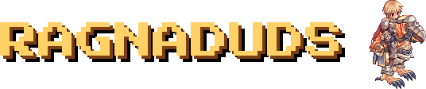
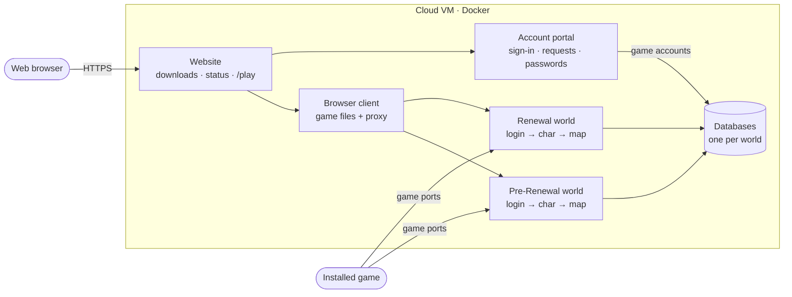
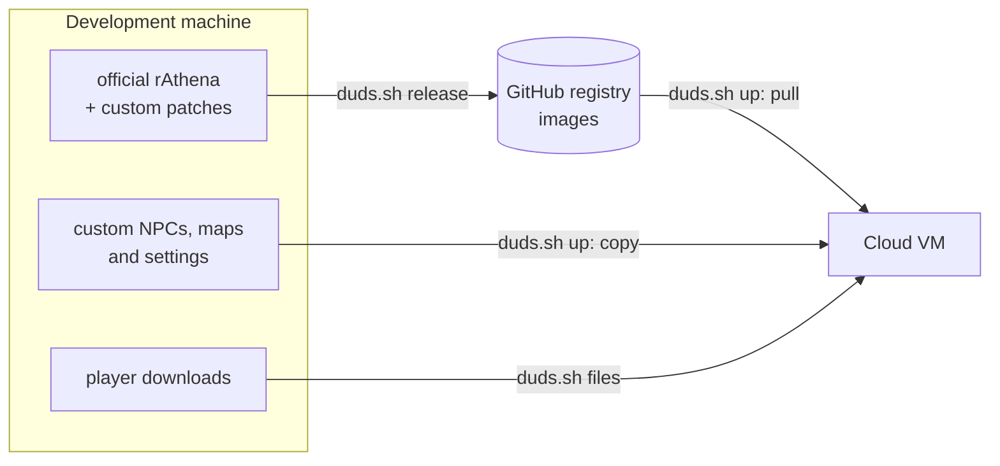

<h1 align="center"></h1>

A private Ragnarok Online server.
It runs on [rAthena](https://github.com/rathena/rathena), the open-source server, with two worlds:
**Renewal** and **Pre-Renewal** (the classic game). Not affiliated with Gravity.

## How it works

Each world is a separate rAthena server made of three programs and its own database. A player signs in to **login**,
picks a character on **char** and plays on **map**. Everything runs in Docker on one cloud VM.

### Playing

Players connect with the installed game or from a browser. The installed game talks straight to the game servers.
The browser client runs on the website and sends the same game traffic through a WebSocket proxy.



### Shipping changes

`duds.sh` runs every step from the development machine. The VM never needs the source code.



- **Images** hold the programs. **Settings and scripts** stay outside them, so most changes need no rebuild.
- **Script changes** also need a map server restart, because `up` alone doesn't reload them.
- **Databases** have no open port. Only the game servers, the portal and the status checker reach them, and backups run every 6 hours.
- **Status checker** reads the databases every 15 s and gives the website its server status and Hall of Fame.
- **Passwords and accounts** live in `deploy/hosts/` and never go into git.

## Quick start
```bash
git clone --recurse-submodules https://github.com/dudustri/ragnaduds-server.git
./duds.sh help                 # every command
./duds.sh start local re       # a server on the local machine
./duds.sh release              # build the images
./duds.sh up vm                # put everything on the VM
```

Update rAthena: `git -C rathena fetch && git -C rathena checkout <commit>`, then `./duds.sh release`.
The build stops if a custom patch no longer fits. Database changes are listed in `rathena/sql-files/upgrades/` and need checking first.

## Docs
| Doc | For |
|---|---|
| [deploy](docs/deploy.md) | putting it on the VM, day-to-day tasks |
| [operations](docs/operations.md) | diagrams and every `duds.sh` command |
| [config](docs/config.md) | rates and settings, and how to change them |
| [special-maps](docs/special-maps.md) | Mapas Especiais, Cheffenia, casino, 4th job quests |
| [browser](docs/browser.md) | playing in the browser (/play, /play-renewal), and the local GRF viewers |
| [grf](grf/readme.md) | making custom maps, sprites and effects |
| [cashshop](docs/cashshop.md) | the Cash Shop and cash points |
| [gm-commands](docs/gm-commands.md) | GM commands, MVPs, jobs, cards |
| [portal](docs/portal.md) | account requests, website login, password reset |
| [website](docs/website.md) | the website |
| [setup](docs/setup.md) | running the servers locally |
| [builds](docs/builds/readme.md) | class builds used for the shop |

## Folders
```
duds.sh       the command center
rathena/      official rAthena (git submodule)
robrowser/    roBrowserLegacy, the browser client (git submodule)
patches/      custom engine changes, applied when the images are built
build/        server images, website, account portal
deploy/       what runs on the VM: compose file, custom scripts, settings (hosts/ is private)
cashshop/     Cash Shop builder
casino/       casino art and sounds
client/       tools for the player download
docs/         documentation
grf/          custom GRF work (maps, sprites, effects), see grf/readme.md
vm_provisioning/  setup for a new VM
```
